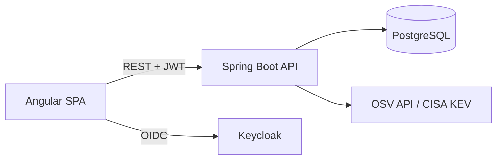

# VulnTrack

[](https://github.com/tarikiguezarane/vulntrack/actions/workflows/ci.yml)
[](LICENSE)

**Cyber Resilience Act (CRA) compliance tracker for SMEs**: SBOM import, automatic
vulnerability matching against OSV, risk dashboard, alerts and ENISA reporting
(24 h early warning, 72 h notification, final report).

> Status: work in progress, built step by step following [ROADMAP.md](ROADMAP.md)
> (progress log in [JOURNAL.md](JOURNAL.md), both in French).

## The problem

The EU Cyber Resilience Act requires manufacturers of products with digital elements to know
what is inside their software and to report actively exploited vulnerabilities to ENISA within
**24 hours**. Most SMEs have neither the tooling nor the team to do it: SBOMs sit unused,
vulnerability feeds are checked by hand and the deadlines are easy to miss.
See [docs/cra.md](docs/cra.md) for a short summary of the regulation.

## Vision

1. **Import** the SBOM (CycloneDX or SPDX JSON) of each product.
2. **Match** every component (package URL + version) against the [OSV](https://osv.dev) database,
   enriched with the CISA *Known Exploited Vulnerabilities* catalog.
3. **Score and prioritise** risk per product, raise alerts on new critical or exploited CVEs.
4. **Report**: guide the user through the CRA incident workflow and generate the ENISA reports
   with their 24 h / 72 h / final deadlines.
5. **Audit**: keep a trace of who did what, for auditors.

## Target architecture



Details in [docs/architecture.md](docs/architecture.md).

| Layer | Technology |
|-------|------------|
| Frontend | Angular, Angular Material |
| Backend | Spring Boot 3, Java 21, Maven |
| Data | PostgreSQL, Flyway |
| Identity | Keycloak (OAuth2 / OIDC) |
| Delivery | Docker, GitHub Actions, GHCR, deployed by [`securepipeline`](https://github.com/tarikiguezarane/securepipeline) |

## Repository layout

```
backend/            Spring Boot API (from Day 2)
frontend/           Angular application (from Day 15)
docs/               Architecture and CRA notes
scripts/            Helper and check scripts
docker-compose.yml  Local development stack
```

## Getting started (local infrastructure)

```bash
cp .env.example .env          # local development values only
docker compose up -d postgres
bash scripts/check-structure.sh
```

## License

[MIT](LICENSE) © 2026 Tarik Iguezarane
