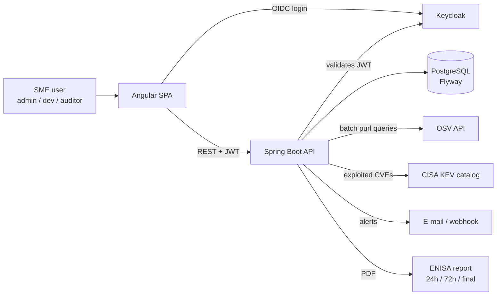

# Target architecture

| Component | Role |
|-----------|------|
| Angular SPA | Product list, SBOM upload, risk dashboard, findings triage, CRA reporting wizard |
| Spring Boot API | SBOM parsing (CycloneDX / SPDX), OSV matching, risk scoring, alerts, audit log, PDF export |
| PostgreSQL | Organisations, products, components, vulnerabilities, findings, incidents, audit trail |
| Keycloak | OAuth2 / OIDC identity provider, roles `admin`, `dev`, `auditor` |
| OSV / CISA KEV | Public vulnerability data sources |

Container images are published to GHCR and deployed by the companion project
[`securepipeline`](https://github.com/tarikiguezarane/securepipeline).
